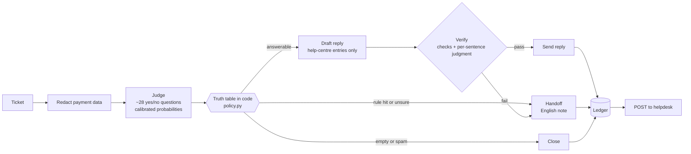

# Quick Response Agent

Support-ticket agent for the **Roosterly** helpdesk. One command reads every open ticket and posts exactly one outcome per ticket:
**reply** in the customer's language, **hand off** to a person with an English note, or **close**.

| | |
|---|---|
| Framework | Agno |
| Decision model (**recommended**) | TypeSafe **Jev 1.14**, default when `TYPESAFE_API_KEY` is set. `gemini-decision-1` is one setting away. |
| Drafting / second opinion | `gemini-3.5-flash-lite` / `gemini-3.8-flash` |
| Result | **66 of 66 labelled cases correct**, 30 of 30 tickets sent in **38.5 s**, **$0.054 per 100 tickets** |
| More | [`docs/RULES.md`](docs/RULES.md) (rules in plain language), [`docs/ARCHITECTURE.md`](docs/ARCHITECTURE.md) (design, measurements) |

## How it works



The model only answers narrow questions; **it never decides and never posts**. The truth table is pure code, and property tests prove it is total.

## How to run

```bash
python -m venv .venv && .venv\Scripts\activate      # source .venv/bin/activate on macOS/Linux
pip install -r requirements.txt
copy .env.example .env      # fill TYPESAFE_API_KEY (recommended), GEMINI_API_KEY, HELPDESK_KEY, CANDIDATE_EMAIL
python -m qra reset --yes && python -m qra run
```

| Command | What it does |
|---|---|
| `python -m qra run` | Process every open ticket. `--dry-run` posts nothing, `--judge gemini` swaps the decision model |
| `python -m qra eval` | Score the 66 labelled cases |
| `python -m qra explain <id>` / `trace <id>` | Why a ticket got its decision, with every probability |
| `python -m qra status` / `audit` | Run state; decisions a person should glance at |
| `python -m qra serve` | Dashboard at http://127.0.0.1:8765 (opens your browser, no Node needed) |
| `pytest` | 289 tests |

**Frontend.** React + Vite in `frontend/`, built into `qra/server/static` and committed, so `serve` is all you need. To change it:
`cd frontend && npm install && npm run build`, then `serve` again. The access link carries a token and is printed at start-up.

| Dashboard part | Use |
|---|---|
| Live run | Progress, decisions, latency, cost |
| Try a ticket | Pick a test case or enter your own (fields or JSON), run either decision model, nothing is posted |
| Bench | Nordavo's labelled examples, our own cases, or the live helpdesk run |

## Decisions

| # | Decision | In short |
|---|---|---|
| 1 | **Judgments from a model, decisions in code** | About 30 typed questions return calibrated probabilities. Client rules (refund, cancellation, personal data, security, legal, churn) escalate from p ≥ 0.3 and can only escalate. |
| 2 | **Dutch and other languages** | Model picks nl / en / de / other. Reply in that language from matched entries only, handoff notes always English, `other` goes to a person, a wrong-language reply fails verification. |
| 3 | **Assumptions where the brief is silent** | Gate probability between 0.3 and 0.7 counts as unsure: never a reply, gets a second draw and, if borderline, a second-opinion agent. Only an empty ticket or clear spam (≥ 0.85) is closed. Refunds and personal data are P2. |
| 4 | **Replies are proven, not trusted** | Sent only if deterministic checks pass (every number, link, menu name is in the help centre or ticket) and no sentence is judged to state anything outside them. Otherwise handoff with the draft attached. |
| 5 | **Tokens are the budget** | Each definition stated once (-21% tokens per ticket). No sampling parameters (no temperature, top_p, top_k). |

## Reliability

| Failure | Handling |
|---|---|
| 503 | Backoff with jitter, 6 tries |
| 429 | Wait `Retry-After`; shared limiter holds 4 req/s |
| 409 | Never retried |
| Crash or restart | Decision is written to a SQLite ledger (unique per ticket and epoch) **before** any POST. A decided ticket is GET-checked, then the stored payload is re-sent, never regenerated. Final run: 30 decided, 30 sent. |
| Any error except an invalid API key | That ticket stays open and is logged; a re-run finishes it |
| Payment data / prompt injection | Redacted before any model call and from every reply and log; ticket text is data, never instructions |

## Results

Labels: Nordavo's 10 examples; 26 cases I wrote from the client rules; and my labels for their 30 practice tickets, each with the
rule behind it (`eval/practice_labels.jsonl`; not their answer key, and it holds no ticket text). Prompts hold no test text: a test
fails if six consecutive words of a case appear in the code.

| Set | Cases | Jev | Gemini |
|---|---|---|---|
| Nordavo examples | 10 | 10/10 | 10/10 |
| Cases I wrote | 26 | 26/26 | 26/26 |
| Practice tickets | 30 | 30/30 | 30/30 |
| **All (language, category, priority, action)** | **66** | **100%** | **100%** |

FAQ match 100%, unsafe replies 0, over-escalation 0.

### Final run: Jev + Flash-Lite drafts

| Measure | Value (average of 4 runs) | Range |
|---|---|---|
| Tickets sent | 30 of 30, 0 errors | |
| Outcomes | 17 handoff, 11 reply, 2 close, all as labelled | |
| Whole run | **42.9 s** (single final run 38.5 s) | 38.5 to 46.3 s |
| Per ticket p50 / p90 / p95 | **5.4 / 8.0 / 9.7 s** | 5.1-5.7 / 6.9-9.3 / 6.9-12.5 |
| Jev call / Flash-Lite draft | about 0.3 s / 1.4 s | |
| **Cost per 100 tickets** | **$0.054** | $0.0537 to $0.0554 |

### Which decision model? I recommend Jev

| | Jev (TypeSafe) | Gemini Decision 1 |
|---|---|---|
| Accuracy on 66 cases | 100% | 100% |
| Full 30-ticket run | **38 s** | about 184 s (free tier caps 50k tokens a minute; that wait is never counted in latency) |
| Cost | **about 30% lower** | higher |

<details>
<summary>Cost breakdown per 100 tickets</summary>

| Part | Tokens | Rate | Per 30 tickets |
|---|---|---|---|
| Jev judgments | 91,090 in | $0.042 / M | $0.0038 |
| Flash-Lite drafts | 7,935 in, 2,898 out | $0.30 / M in, $2.50 / M out | $0.0096 |
| Second opinion (3.8 Flash) | | | $0.0026 |
| **Total** | | | $0.0161, x 100/30 = **$0.054** |

</details>

Every judgment is a calibrated probability: all 28 per ticket are in the run log, and the ticket's confidence is stored in the ledger
with its decision before anything is sent.

| Evidence in this repo | File |
|---|---|
| All 66 cases: decision, rule row, probabilities, confidence | `eval/results/final-jev.json`, `final-gemini.json` |
| My labels and the rule behind each | `eval/practice_labels.jsonl` |
| Final run: decision, confidence, 28 judgments, tokens, time per ticket | `logs/run-20261123-110121.jsonl` |
| Verification experiment / retrieval comparison | `eval/results/verify-ab.json`, `final-cascade.json` |

Fixes that mattered (details in `docs/ARCHITECTURE.md`): sharper "this is not X" question clauses, a `time_critical` question,
verification at 0.7 with greetings decided in code.

## AI tool use

I built this with an AI coding assistant working under my direction. It wrote much of the code and tests; I set the requirements and
design rules, chose the thresholds and reviewed the labels and results.

## What I would improve

| Next step | Why |
|---|---|
| **Self-host** an open decision model and a small open LLM on vLLM | The judge uses typed questions over one protocol and the rules are code, so a compatible endpoint replaces the hosted models without touching questions or truth table; cost becomes GPU time. Candidates: Laya, LiquidAI d1-omni-600M, TurinTech d3-27B-Artemis. Not built or measured here. |
| Trade accuracy for cost | One choice question for all entries -48% tokens, cascade retrieval -20%, no repeat draw -19% (table in `docs/ARCHITECTURE.md`) |
| Tune thresholds on real traffic | Mine come from the rules and 66 labelled cases; `python -m qra audit` lists decisions a person should glance at |
| Scale out | Shared Redis queue and Postgres ledger for many workers (`docs/ARCHITECTURE.md`, section 17) |
| Clearer client rules | They should state priorities for refunds and personal-data requests |
